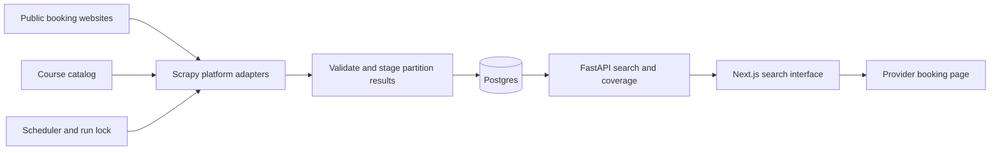

# Golf Booker — design document

Proposed design, 16 October 2026. Existing behaviour is identified explicitly; all extensions below are planned, not implemented by this document.

**Stack decision update:** option 4 is selected. Production will use a Next.js static export on Cloudflare Pages, Supabase Free Postgres with bounded public SQL RPCs, and Python/Scrapy on GitHub Actions. The FastAPI architecture and HTTP contract below describe the original baseline; migrate that search behaviour into SQL RPCs and update the TypeScript client rather than deploy a separate FastAPI service. Preserve timezone, freshness, partition reconciliation and capacity semantics. Apply the [zero-spend controls](PROJECT_PLAN.md#zero-spend-controls-for-selected-option-4), including narrow anonymous grants, no public writes, query limits and a public-search disable switch. Provider billing protection takes precedence over background collection when quotas run out.

## Architecture

The existing system already separates collection from search. Searches must continue to read Postgres without triggering requests to booking websites. Start with a single scheduled scraper worker, API service, web service and managed Postgres. A queue or distributed scheduler is unnecessary for the proposed launch size.

## User experience

1. Choose a date from today through today + 14 days inclusive in the course’s timezone (15 calendar dates), local start/end times, players, holes and optionally courses.
2. Submit and see a loading state. Cancel or ignore superseded requests so slow responses cannot replace newer searches.
3. Show matching bookable groups with course-local date/time and timezone, location, holes, spots, price per player per round, currency and slot observation age.
4. Sort by time or price. MVP launch sources should use AUD; if other currencies are enabled, group by currency or disable cross-currency price sorting.
5. Open the provider booking link. Explain that the provider confirms availability and final pricing.

Show a coverage summary even when there are no results: for example, “No matching tee times across 2 checked courses; 1 course is temporarily unavailable.” An empty result alone cannot establish that all courses are fully booked. Use customer-facing service errors, keyboard-accessible fields, visible labels and mobile layouts. Avoid the current development instruction to start the API in production errors.

## Catalog and source integration

Keep `scraper/courses.yaml` as the curated source list. Add an explicit enabled/environment flag and validate platform parameters before scheduling. Production seeding must exclude all `stub-*` courses and fixture-only adapters; disabling a course must also exclude previously seeded rows from search. Secrets belong in environment configuration, never the catalog or fixtures.

For each real website, record course slug, booking URL, platform, local timezone, hole options, request parameters, supported date horizon, price meaning, access constraints and tested response examples. Prefer permitted structured endpoints when available; use HTML parsing where necessary. Add browser automation only if a verified source requires it and its cost fits the schedule.

Retain robots handling, one concurrent request per domain, the existing one-second minimum delay and adaptive throttling as the starting policy. Tune down request rates to source-specific limits. Add bounded retries/backoff for transient failures, request timeouts and a worker deadline. Do not bypass login requirements, CAPTCHA or other access controls.

Mandalay currently schedules 14 days × two fee groups = up to 28 sheet requests per run, excluding robots, retries and redirects. The new inclusive two-week requirement needs 15 dates (offsets 0–14), increasing that to up to 30 sheet requests. Change both request generation and reconciliation bounds together: use [local midnight today, local midnight today + 15 days). Confirm this cadence is appropriate before enabling it. Serial adapter execution must fit within the schedule interval; otherwise reduce coverage/cadence or introduce bounded parallelism across independent domains.

## Data model

Existing tables:

| Table | Current role | Proposed extension |
| --- | --- | --- |
| `courses` | Catalog metadata, timezone, booking URL and platform | Enabled/production status; optionally coverage horizon and cadence configuration |
| `tee_times` | Current availability, price, UTC start, booking URL and observation timestamp | Stable bookable-group key, source scope and optional provider slot identifier |
| `scrape_runs` | One mutable health summary per course | Retain as summary; add separate historical execution and coverage records |

Current uniqueness is `(course_id, starts_at, holes)`. MiClub currently sums availability from 1st and 10th tee rows sharing that key. Two groups of two spots must not match a party of four. Propose uniqueness `(course_id, source_slot_key, holes)` where the key identifies the actual bookable group (provider ID, or a documented stable composite including local date/time and starting tee). If a source cannot establish that capacity is jointly bookable, do not claim it can accommodate the party. Preserve differing tariffs without silently overwriting prices; MVP selects a documented public adult rate.

Add `scrape_executions` with execution ID, course ID, start/finish timestamps, status, expected/completed partition counts, accepted/rejected item counts and sanitised error code. Add partition records keyed by execution, local date and source fee-group/resource scope. Represent success-with-items, verified-empty, failed and incomplete separately. Use constraints, foreign keys and indexes for enabled-course/time search and execution/partition lookup; confirm index choices with query plans rather than adding them speculatively.

Use an Alembic migration and regenerate cached tee times after the identity change; tee times are derived data. Preserve course identifiers and operational history. Back up before deployment and ensure old code cannot write using the former uniqueness contract during migration.

## Collection and reconciliation

1. Acquire a run lock so scheduled jobs cannot overlap; create execution and expected partition records.
2. Fetch each course/date/resource partition. Validate response identity, date, structure and completion markers. A missing expected selector, access page or network failure is not a valid empty sheet.
3. Normalise bookable groups into aware UTC timestamps, hole count, nonnegative capacity, decimal price, currency, price unit and permitted HTTP(S) booking link. Reject invalid or already-past groups. Deduplicate by stable source identity.
4. Stage results for a partition. Mark verified-empty only when the response positively establishes successful complete coverage with zero slots.
5. In one transaction per complete partition, upsert its current slots and remove absent old slots only within that partition. Failed or incomplete partitions retain previous rows and timestamps. A successful partition may publish independently; course coverage must disclose remaining failures.
6. Commit partition outcomes and update the course summary. Record valid empty collection as success. Expose partial failures to monitoring even if the process returns exit code zero.
7. Expire past records on a retention schedule, and release the lock on exit or timeout. Retain execution history for a proposed 30 days initially.

The current pipeline writes partial items even when a course later errors, and only deletes old rows after a nonempty error-free course run. The proposed staging and partition transactions replace that behaviour. Missing, closed and sold-out dates require explicit handling and fixtures.

## Search contract

Retain `GET /api/courses`, `GET /api/tee-times`, and `GET /api/health`; extend them compatibly where possible. The current search accepts required `date`, `time_from`, `time_to`, `players`, optional `holes`, and `sort=starts_at|price`.

Planned search additions: repeated `course_slug` parameters; `limit` (default 100, maximum 200) and offset pagination initially; response metadata with returned count, limit/offset, coverage and server time. Stable ordering includes price when requested, then UTC start, course and slot identity. Use an explicit response schema and update TypeScript types together.

Interpret date and clock bounds in each selected course's IANA timezone; bounds are inclusive. Require `starts_at > now`, `spots_available >= players` and `scraped_at >= now - 60 minutes`. Accept party sizes 1–4 for the MVP, unless source verification establishes another supported range. Reject backwards or cross-midnight windows, unsupported holes, unknown/disabled courses, and dates outside selected-course coverage. For differing timezones, validate the horizon per course and disclose excluded coverage; launch in Melbourne to minimise ambiguity. The application horizon includes local today +14 and excludes +15; update the date picker, API validation, request generation and cleanup scope consistently. Distinguish provider dates not yet released from verified empty availability. Include day +14, day +15, local midnight rollover and daylight-saving tests.

The API currently filters freshness but does not explicitly exclude tee times that have passed since collection. Add that predicate. Use slot `scraped_at` for result freshness; `last_success_at` describes course collection health and can overstate the freshness of a particular retained slot.

Expose public course coverage/status and a sanitised reason through health/search metadata. Keep raw parser errors, provider payloads and internal stack traces in operator logs. Provide a separate service readiness endpoint checking database connectivity; existing `/api/health` is source health, not service readiness.

## Deployment and operations

The production website must be hosted at a public HTTPS URL and usable by anyone without an application account, VPN or local development services. Host the web frontend, API, scheduled scraper worker and persistent Postgres database; only the web/API endpoints are public. Keep database access private and operator access authenticated. Provider websites may impose their own registration and booking rules. Hosting provider, domain and budget are implementation decisions to resolve in Sprint 1.

Verify anonymous search and booking handoff from an external network on mobile and desktop. Configure public DNS and TLS, production API routing/CORS, automatic service restart, request limits and bounded queries. Scheduled collection must continue when no user is visiting the site.

Use separate staging and production environments, TLS, environment-specific API URL/CORS origins and least-privilege database credentials. Run migrations and catalog validation as a controlled release step. Keep fixture loaders out of production collection paths. Configure backups, retention and a tested restore procedure before launch.

Log execution ID, course, partition, duration, item counts and outcome. Measure scheduling lag, source success rate, partition freshness, HTTP failures, API latency/errors and worker duration. Proposed alerts: two consecutive course collection failures, no completed coverage for 30 minutes, worker duration approaching the 15-minute interval, and database/API unavailability. Tune thresholds during the soak to prevent noise.

On source failure, continue other sources, preserve last-known records without refreshing their timestamps, hide expired slots and show partial coverage. On release failure, roll back application images when schema-compatible; otherwise pause workers and follow the migration recovery runbook. A restore rehearsal must document recovery time and data loss observed; production recovery objectives remain a hosting decision.

## Verification and release gates

Use parser fixtures for real, empty, sold-out, malformed, blocked and changed pages; verify slot identity, party capacity, fees and timezone handling. Test partition atomicity, safe deletion, retries, partial failures, overlap locks and idempotent reruns against Postgres. Tests that skip without Postgres do not count as an integration pass.

API checks cover future-only filtering, exact 60-minute freshness boundary, local time bounds, 9/18/either holes, party size, disabled courses, pagination and ordering. Add browser journeys for search, sorting, provider handoff, no availability, partial coverage, API errors and superseded searches. Run frontend lint/build and mobile/keyboard review.

Release gates and performance targets are defined in [project plan](PROJECT_PLAN.md); delivery sequence is in [timeline](TIMELINE_AND_SPRINTS.md). No new library versions, source permissions or live endpoint reliability were assumed from external research; validate these during implementation.
