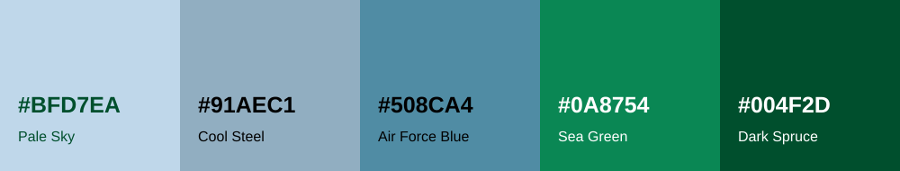

# Tee Time — UI design document

**Date:** 5 November 2026 · **Status:** Local UI preview for review

This document defines the website’s visual style using the five colours in your
reference image. It also records the simpler starting page you requested.
The palette and simpler layout are implemented in the local preview, including
light/dark mode and a top-left theme toggle. Hosted websites remain unchanged.

The existing [technical design document](DESIGN_DOCUMENT.md) covers architecture.
This document covers what people see and how they use the website.

## 1. Design direction

Make finding a round feel quick and clear. The starting page should help someone
choose a date, players and holes immediately. The results should make it easy to
compare courses and times, then open the course’s booking page.

Use generous space, readable text, short labels and one main action per screen.
Keep useful availability information visible. Remove slogans, numbered steps,
decorative illustrations and repeated instructions from the starting page.

## 2. Colour palette



These hex values are taken from the labels in your screenshot.

| Colour | Hex | Main use |
| --- | --- | --- |
| Pale Sky | `#BFD7EA` | Light blue highlights, 9-hole slots, subtle selected or hover backgrounds |
| Cool Steel | `#91AEC1` | Decorative dividers and secondary chart structure |
| Air Force Blue | `#508CA4` | Calendar accents, control borders and supporting icons |
| Sea Green | `#0A8754` | Primary buttons and 18-hole slots |
| Dark Spruce | `#004F2D` | Headings, body text, selected outlines and button hover states |

White (`#FFFFFF`) supports the palette as the background for cards, dropdowns
and the calendar. Use a very light blue page background (`#F2F7FB`), derived by
mixing approximately 20% Pale Sky with 80% white. Avoid large areas of saturated
green or blue behind reading content.

Green identifies actions and bookable offers. Blue organises the page and helps
people read the calendar. Use the same roles on both pages.

### Readable colour combinations

Ratios below were calculated from the exact hex values with solid colours.
Normal-size text should meet the 4.5:1 contrast threshold described in
[W3C’s contrast guidance](https://www.w3.org/WAI/WCAG22/Understanding/contrast-minimum.html).
This is a palette check, not a full accessibility audit of the finished app.

| Text → background | Contrast | Decision |
| --- | --- | --- |
| Dark Spruce → white | 9.74:1 | Main text and headings |
| Dark Spruce → Pale Sky | 6.55:1 | Text on blue slots and highlights |
| White → Dark Spruce | 9.74:1 | Hovered buttons or strong selected states |
| White → Sea Green | 4.56:1 | Primary buttons and green slots; keep both colours fully opaque |
| White → Air Force Blue | 3.73:1 | Avoid for small text |
| Dark Spruce → Cool Steel | 4.19:1 | Avoid for small text |
| Sea Green → Pale Sky | 3.07:1 | Avoid for small text |

Keep small supporting text Dark Spruce rather than making it faint. Use spacing,
size and weight to establish importance. Cool Steel dividers are decorative;
controls are borderless and use contrasting background surfaces. Use a Dark
Spruce focus outline with a white gap so keyboard focus remains visible on both
blue and green controls. Recheck contrast if transparency or new shades are used.

## 3. Starting page

Keep the brand and a short heading: **Find your next round.** A small location
label can remain because it explains which area the service covers.

The form has exactly three visible labels:

| Label | Options | Initial value |
| --- | --- | --- |
| Pick a date | Today through 14 days ahead | Today |
| How many players? | 1, 2, 3 or 4 | 2 players |
| How many holes? | 9 holes, 18 holes, or 9 or 18 holes | 18 holes |

The main button says **Find tee times**. Use Sea Green with white text and Dark
Spruce on hover. Dropdowns stay white with Dark Spruce labels and values.

On desktop, place the three fields and button in one white card. On mobile,
stack them in the same order and make the button full width. Keep the form near
the centre of the viewport together with its heading. Navigation and the theme
toggle remain at the top left. Short screens can scroll instead of clipping the form.

Remove the intro slogans, “Three choices. Then you’re on your way.”, numbered
field captions such as “01 / WHEN”, the repeated form heading, decorative course
art and the marketing footer. Place the final-booking explanation alongside the
booking action on the results page, where it helps someone make a decision.

## 4. Results page

The order of importance is: selected date → players and holes → available times
and prices → details for the chosen round → booking action.

Keep the flight-search layout: date choices above the calendar, times across the
top and clubs down the left. Keep the time header and course names visible while
scrolling. Today’s axis begins at the current course-local minute and past times
are hidden. Other dates retain the full-day timeline, including early tee times.

| Element | Treatment |
| --- | --- |
| Selected date | Dark Spruce fill, white text and an explicit selected state |
| Other dates | White surface, Dark Spruce text, Pale Sky hover |
| Calendar | White surface with subtle blue grid lines |
| Course names and time labels | Dark Spruce, readable without hovering |
| 18-hole offer | Sea Green with white text |
| 9-hole offer | Pale Sky with Dark Spruce text |
| Chosen offer | Dark Spruce outline with a contrasting white gap |
| Offer information | Time, price per player and a short “9h” or “18h” label |

The hole label must be visible, so colour is not the only way to distinguish
round lengths. Keep nearby tee times in separate lanes when their cards would
overlap. Card width and lane spacing must be checked together when adding labels.

Use one compact search summary and a secondary **Refresh results** button.
Keep course-specific messages beside the relevant club. Remove repeated slogans
and instructions that do not help someone search or choose a round.

Selecting a time opens a details panel with the course, date, time, holes, spots,
price per player and actual last-update time. **Book with course** is the main
action there. Explain that the course confirms final availability and price.
The panel has a labelled close button; Escape closes it and returns keyboard
focus to the chosen time.

## 5. Loading, empty and error states

Simplifying the page must not hide the reason a course has no times.

| Situation | Message or behaviour |
| --- | --- |
| Search loading | “Loading tee times…”; acknowledge the search immediately |
| No date collection | “Not checked for this date” |
| Unsupported round length | “18-hole availability isn’t collected for this course.” |
| Verified empty sheet | “No offers when checked” |
| Capacity filter removes offers | “No matches for 4 players”, using the selected number |
| Source cannot be verified | “Availability unconfirmed” |
| Collection is too old | “Collection is out of date” |
| Search service fails | “We couldn’t load tee times. Try again.” with a retry action |

Use plain text and an icon where helpful. Blue and green alone cannot communicate
success or failure. Preserve date, player and hole choices when a request fails.
Refresh reads saved results; it should not promise that the golf websites have
just been checked. Show the real observation timestamp in round details.

## 6. Type, spacing and small screens

Keep the existing serif style for the main heading and use the existing system
sans-serif font for everything else. No additional font download is needed.

| Item | Proposed size |
| --- | --- |
| Page heading | 48–64 px desktop; 36–42 px mobile |
| Body text and dropdown values | 16 px |
| Field labels | 14 px, medium weight |
| Supporting details | 12–14 px where practical; essential information stays readable |
| Buttons and controls | At least 44 px high as a design target |
| Spacing | Use 8, 16, 24 and 32 px steps |
| Corners | 8 px controls; 16 px main cards |

Use restrained shadows. Let spacing and background surfaces define groups. At narrow widths,
the form stacks and the calendar scrolls inside its own region. The rest of the
page must not overflow horizontally. Show a short scroll hint only when useful.
Keep native dropdown behaviour, visible field labels and a logical keyboard order.

## 7. Applying your UI principles reference

Reference: [Dribbble — 10 Fundamental UI Design Principles](https://dribbble.com/resources/education/ui-design-principles).
These are the concrete checks we will use for this app:

| Principle | Application |
| --- | --- |
| Simplicity | Three starting fields; remove marketing clutter. |
| Anticipate needs | Default to today; show future dates immediately. |
| User control | Let people change filters and close details freely. |
| Consistency | Reuse labels, button styles and colour meanings. |
| Reduce complexity | Keep round details beside the calendar. |
| Clear signposts | Highlight the chosen date and label every control. |
| Forgive mistakes | Preserve choices through retries and back navigation. |
| Relevant feedback | Show loading, failures and actual observation times. |
| Prioritise functions | Emphasise search first, booking after selection. |
| Accessibility | Combine colour with text and visible keyboard focus. |

## 8. Implementation notes for later

Apply the shared tokens in `web/src/app/globals.css`, then update component rules
in `web/public/round.css`. Use shared variables instead of scattering hex codes
through the stylesheet. The intended base mapping is:

```css
:root {
  --background: #F2F7FB;
  --foreground: #004F2D;
  --card: #FFFFFF;
  --line: #91AEC1; /* Decorative dividers only. */
  --fairway: #0A8754;
  --fairway-ink: #FFFFFF;
  --muted: #004F2D; /* Reduce emphasis through size/weight, not low contrast. */
  --sky: #BFD7EA;
  --steel: #91AEC1;
  --blue: #508CA4;
  --spruce: #004F2D;
}
```

Use background surfaces to distinguish borderless controls and `--spruce` for focus.
Review existing green, cream and orange hardcoded colours as part of the change.
The local preview includes the intro cleanup, borderless controls, centred
starting form and a saved light/dark preference.

Before publishing, review the starting page and results on desktop and mobile;
check all three hole options, today and day +14, loading/errors and the details
panel; verify keyboard operation, zoom and colour contrast in actual components.
Keep the source collection, API, availability rules and current-time behaviour
unchanged by this visual work. A local Git commit is now authorised. Pushes and deployment remain on hold.

## Brand artwork

The user-supplied golf-green illustration is the navigation logo on both the
starting and results pages: `web/public/branding/tee-time-logo.png`. The second
landscape illustration is the shared-link preview for Open Graph and Twitter:
`web/public/branding/tee-time-preview.jpeg`. Both original JPEG files remain in the repository. The displayed logo uses a
transparent PNG created with the built-in image tool. Prompt: remove only the
white outside background; preserve the drawing, colours, rough edges and
composition. This allows the page colour to show around the logo in both themes. The preview is link metadata, not a page background.
